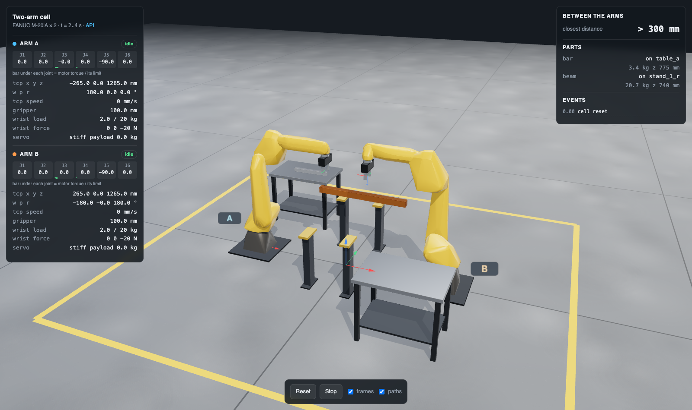

# two-arm-sim

Two FANUC M-20iA arms in one cell, simulated with real physics (MuJoCo): motors drive the joints, the jaws hold parts
by friction. The arms are not connected to each other. Each has its own controller, reached at its own address:

    arm A    http://127.0.0.1:8700/api/arm/a/...
    arm B    http://127.0.0.1:8700/api/arm/b/...

This document covers three things: install, start, and connect to each arm. Every endpoint, with a real request and
response, is in [API.md](API.md).

## 1. Install

Needs Python 3.10 or newer. Nothing else: the robot model and the viewer are in this folder.

    cd two-arm-sim
    pip install -r requirements.txt          # numpy and mujoco

To also run the tests: `pip install pytest`, then `python3 -m pytest tests -q` (22 tests, about 20 s).

## 2. Start

    ./run.sh                                 # same as: python3 -m twoarm.server

It prints the address and keeps running until Ctrl-C:

    two-arm-sim   viewer http://127.0.0.1:8700/   API http://127.0.0.1:8700/api   (Ctrl-C to stop)   real-world errors, seed 1

Open **http://127.0.0.1:8700/** in a browser to watch the cell. The page shows both arms' joint angles, tool
position, motor load, wrist force and gripper, and has Reset and Stop buttons.

Options:

| option | what it does |
|---|---|
| `--port 9000` | another port |
| `--host 0.0.0.0` | reachable from other machines on the network (default: this machine only) |
| `--ideal` | a perfect cell: no calibration or placement errors |
| `--seed 7` | another draw of the real-world errors (default 1). `GET /api/reality` shows them |
| `--fast` | run about 10x faster than real time |

By default the cell has realistic errors: each arm stands a millimetre or so from where the layout says, the tool is
2-4 mm from where its controller believes it is, and parts lie a few millimetres and up to a degree or two off. Use
`--ideal` while getting connected, then drop it.

## 3. Connect to each arm

Everything is HTTP with JSON, so any language works. Below: `curl`, then Python.

Units are metres, radians, seconds, newtons (fields ending in `_deg` are degrees). Positions are in the **world**
frame unless you add `"frame": "base"`: z up, floor at z = 0, origin midway between the arms. Arm A stands at
x = -1.25 m facing +x, arm B at x = +1.25 m facing -x.

### Read an arm

One call returns both arms; pick yours out of `arms`.

    curl http://127.0.0.1:8700/api/state

    {"t": 12.4,
     "arms": {
       "a": {"status": "idle", "fault": null,
             "joints_deg": [0.0, 0.0, 0.0, 0.0, -90.0, 0.0],
             "tcp": {"world": {"pos": [-0.265, 0.0, 1.265], "wpr_deg": [180.0, 0.0, 0.0], ...},
                     "base":  {"pos": [0.985, 0.0, 1.265], ...}},
             "joint_torque": [...], "motor_load": [...],
             "wrist": {"force": [0.0, 0.0, -19.6], "torque": [...]},
             "gripper": {"width": 0.1, "squeeze_n": 0.0, "holding": null}, ...},
       "b": { ... the same fields ... }},
     "parts": {"bar": {...}, "beam": {...}},
     "arm_distance": null, "touching": []}

`status` is `idle`, `moving` or `fault`. `tcp` is the tool's working point between the jaws.

### Move arm A

    # joint move (degrees), at half speed; "wait" holds the reply until the arm is at rest
    curl -X POST http://127.0.0.1:8700/api/arm/a/move_joint \
         -d '{"joints_deg": [20, 10, -10, 0, -80, 0], "speed": 0.5, "wait": true}'

    # put the tool at a point, pointing straight down
    curl -X POST http://127.0.0.1:8700/api/arm/a/move_pose \
         -d '{"pos": [-0.4, 0.3, 1.0], "tool_down": 0, "wait": true}'

    # straight line to a point, 0.25 m/s
    curl -X POST http://127.0.0.1:8700/api/arm/a/move_line \
         -d '{"pos": [-0.4, 0.3, 0.8], "speed": 0.25, "wait": true}'

    # gripper
    curl -X POST http://127.0.0.1:8700/api/arm/a/gripper -d '{"action": "close", "wait": true}'
    curl -X POST http://127.0.0.1:8700/api/arm/a/gripper -d '{"action": "open",  "wait": true}'

### Move arm B

The same calls with `b` in the address. Arm B is a separate controller: it queues and runs its own moves whatever
arm A is doing.

    curl -X POST http://127.0.0.1:8700/api/arm/b/move_pose \
         -d '{"pos": [0.4, -0.3, 1.0], "tool_down": 0, "wait": true}'
    curl -X POST http://127.0.0.1:8700/api/arm/b/gripper -d '{"action": "close", "wait": true}'

### Every command an arm takes

Replace `{arm}` with `a` or `b`.

| address | body | what it does |
|---|---|---|
| `POST /api/arm/{arm}/move_joint` | `joints` (rad) or `joints_deg`, `speed` 0-1 | joint move |
| `POST /api/arm/{arm}/move_pose` | `pos`, orientation, `speed` 0-1 | joint move ending with the tool at a pose |
| `POST /api/arm/{arm}/move_line` | `pos`, orientation, `speed` m/s | straight-line tool move |
| `POST /api/arm/{arm}/gripper` | `action` `open`/`close` or `width` m, `force` N | jaws; parts are held by friction |
| `POST /api/arm/{arm}/payload` | `mass` kg | tell the controller what the arm carries |
| `POST /api/arm/{arm}/soft_float` | `enabled`, `stiffness` 0.01-1 | make the arm compliant |
| `POST /api/arm/{arm}/stop` | | drop its queued moves |
| `POST /api/arm/{arm}/reset_fault` | | clear a fault |

Orientation is one of `tool_down: <yaw deg>`, `wpr_deg: [W, P, R]` (FANUC), `quat_wxyz`, or a 3x3 `matrix`. Leave it
out and the tool keeps the orientation it has.

A move replies at once with an id and the planned duration, and queues behind the arm's earlier moves. Add
`"wait": true` to get the reply when the arm has stopped.

### When a command is refused or the arm faults

A refused command changes nothing and says why (HTTP 4xx):

    {"ok": false, "error": "unreachable", "message": "arm a cannot reach that pose", "pos": [3.0, 0.0, 1.0]}

`collision` means the planned path would hit something, including the other arm's queued path.

A fault is the arm protecting itself from what it measures: `collision_detect` (a motor is working much harder than
its controller expected) or `following_error` (a joint is more than 3 degrees off its command). The arm stops,
`state.arms.{arm}.fault` says which joint, and it ignores moves until:

    curl -X POST http://127.0.0.1:8700/api/arm/a/reset_fault

### Kinematics for an arm

    # forward: joint angles -> tool pose
    curl -X POST http://127.0.0.1:8700/api/fk -d '{"arm": "b", "joints_deg": [20, 10, -15, 30, -70, 45]}'

    # inverse: tool pose -> every joint solution inside the limits, nearest first
    curl -X POST http://127.0.0.1:8700/api/ik -d '{"arm": "b", "pos": [0.3, -0.2, 1.0], "tool_down": 0}'

The same maths without the server: `from twoarm import robot as R`, then `R.fk(q, tcp_z=0.2)`, `R.ik(T, tcp_z=0.2)`,
`R.jacobian(q, tcp_z=0.2)` (poses in the arm's base frame).

### Both arms in one call

The two controllers stay separate; these two calls plan for both at once.

    # each arm its own move, starting and arriving together
    curl -X POST http://127.0.0.1:8700/api/together/move \
         -d '{"a": {"type": "pose", "pos": [-0.4, 0.3, 1.1], "tool_down": 0},
              "b": {"type": "pose", "pos": [0.4, -0.3, 1.1], "tool_down": 0}, "wait": true}'

    # move a part that the grippers are holding; each gripper follows it
    curl -X POST http://127.0.0.1:8700/api/together/move_part \
         -d '{"part": "beam", "pos": [0.0, 0.55, 1.1], "speed": 0.2, "wait": true}'

Whole cell: `POST /api/wait` (until everything is at rest), `POST /api/stop`, `POST /api/reset`.

### From Python

`twoarm/client.py` is a 30-line client using only the standard library.

    from twoarm.client import Client, ApiError

    c = Client("http://127.0.0.1:8700")
    c.post("/api/reset")

    a = c.get("/api/state")["arms"]["a"]
    print(a["status"], a["joints_deg"], a["tcp"]["world"]["pos"])

    c.post("/api/arm/a/move_pose", pos=[-0.4, 0.3, 1.0], tool_down=0, wait=True)
    c.post("/api/arm/b/move_pose", pos=[0.4, -0.3, 1.0], tool_down=0, wait=True)

    try:
        c.post("/api/arm/a/move_pose", pos=[3.0, 0.0, 1.0], tool_down=0)
    except ApiError as e:
        print(e.status, e.body["error"])          # 422 unreachable

A longer example is in `examples/quickstart.py` (run it with the server up: `python3 examples/quickstart.py`).

## What is in the cell

| | |
|---|---|
| Arms | 2 x FANUC M-20iA: 6 axes, 1811 mm reach, 20 kg payload |
| Gripper | two-finger, 0-120 mm opening, 500 N per jaw, working point 200 mm from the flange, force/torque sensor at the wrist |
| Fixtures | `table_a` and `table_b` (750 mm high), two pairs of stands (700 mm) |
| Parts | `bar` 500x50x50 mm, 3.4 kg on table A · `beam` 1200x80x80 mm, 20.7 kg on the first stands |

`GET /api/scene` returns all of it as numbers. The layout is in `twoarm/scene.py`.

## Limits of the simulation

- FANUC publishes no link masses, motor torques or friction. They are estimated, all in
  `robot/dynamics_estimated.json` (derivation in `twoarm/dynamics.py`). Motions and trends are physical; a specific
  torque or slip force is not your arm's number until those values are measured.
- The sizes of the real-world errors (`twoarm/reality.py`) are typical figures, not measurements of your cell.
- There is no FANUC controller interface here (no TP programs, RMI or stream motion), no camera, no sensor noise.
- Joint angles follow the URDF. A FANUC pendant shows J3 coupled to J2; the state also gives `joints_fanuc_deg`.
  Confirm that mapping on a real controller.

Licences: `robot/` is the ROS-Industrial FANUC M-20iA description (BSD, `robot/LICENSE`); `viewer/lib/` is three.js
(MIT, `viewer/lib/LICENSE-three.txt`).
